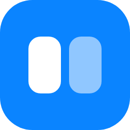
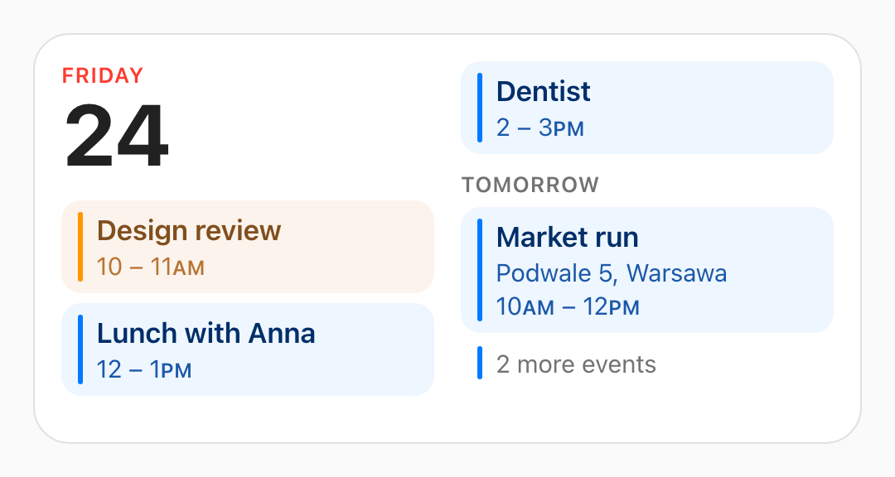
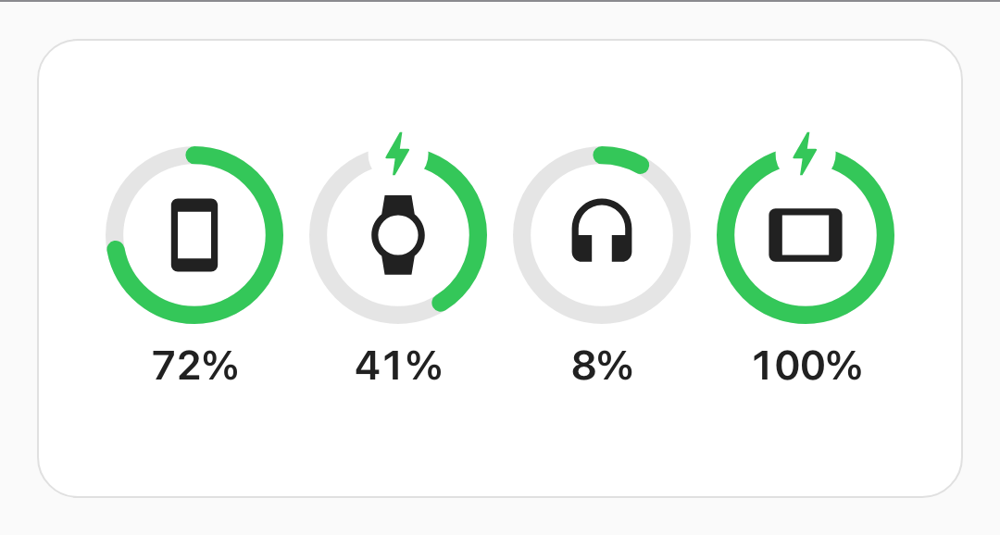
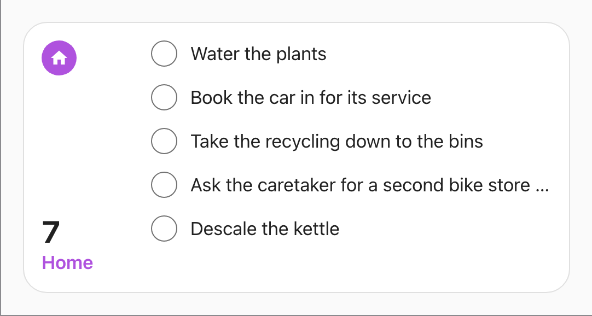
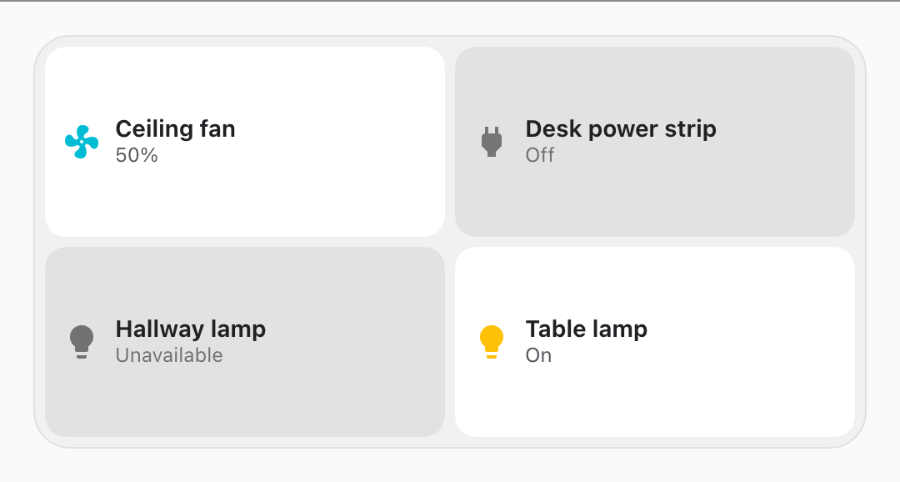
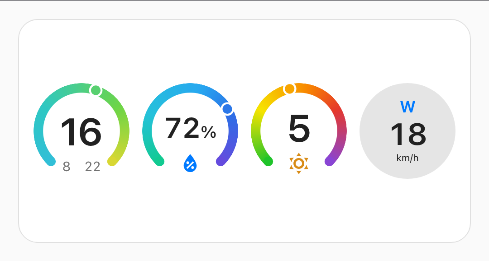
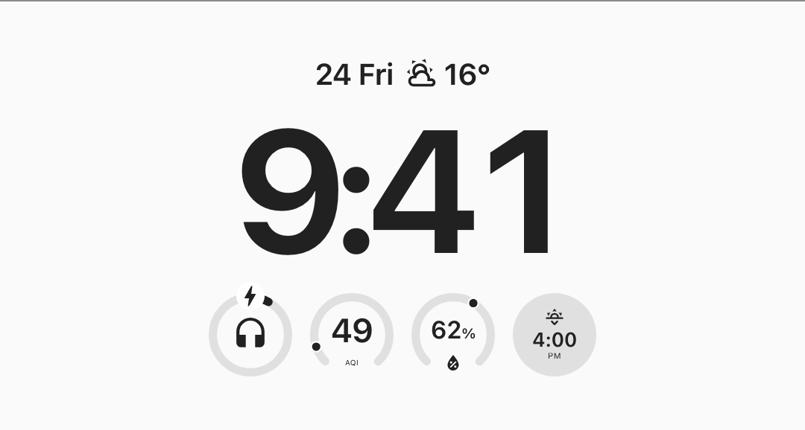

# Cupertino Widgets

> ## 🚀 Kiryl Viarenich — Senior Full-Stack Developer
>
> **I'm currently open to new opportunities and looking for a job.**
>
> Senior full-stack developer with 6 years of experience, strongest in React and Node.js/NestJS,
> used to owning a feature from the schema through to the screen.
>
> 💼 [LinkedIn](https://www.linkedin.com/in/kiryl-viarenich)

Phone-style dashboard cards for Home Assistant 2026.7 or newer. Resize them in the
dashboard’s **Layout** tab and the contents adapt to the space.

**[Live demo](https://sabbaken.github.io/cupertino-widgets/)** ·
**[Install](#install)** ·
**[Configuration](#adding-a-card)**

Try the widgets with sample data in the demo and copy the configuration for your dashboard.

[](https://ko-fi.com/sabbaken)
[](https://buymeacoffee.com/sabbaken)

[](https://github.com/sabbaken/cupertino-widgets/actions/workflows/ci.yml)
[](https://github.com/sabbaken/cupertino-widgets/actions/workflows/release.yml)
[](./LICENSE)
[](https://www.home-assistant.io/)

## Widgets

<table>
  <tr>
    <td align="center" valign="top" width="50%">
      
      <br />
      <b><a href="#the-calendar">Calendar</a></b><br />
      <sub>Calendar events and dated to-dos.</sub>
    </td>
    <td align="center" valign="top" width="50%">
      
      <br />
      <b><a href="#the-batteries">Batteries</a></b><br />
      <sub>Battery levels and charging status.</sub>
    </td>
  </tr>
  <tr>
    <td align="center" valign="top" width="50%">
      
      <br />
      <b><a href="#the-reminders">Reminders</a></b><br />
      <sub>A to-do list you can tick off from the dashboard.</sub>
    </td>
    <td align="center" valign="top" width="50%">
      
      <br />
      <b><a href="#cupertino-controls">Controls</a></b><br />
      <sub>Shortcuts for lights, fans, switches and other devices.</sub>
    </td>
  </tr>
  <tr>
    <td align="center" valign="top" width="50%">
      
      <br />
      <b><a href="#cupertino-complications">Complications</a></b><br />
      <sub>Sensor and weather readings in rings, dials and discs.</sub>
    </td>
    <td align="center" valign="top" width="50%">
      
      <br />
      <b><a href="#cupertino-clock">Clock</a></b><br />
      <sub>Time and date, with optional weather and up to four readings.</sub>
    </td>
  </tr>
</table>

## Install

Through [HACS](https://hacs.xyz/), which is where a dashboard card belongs; it registers the
resource for you and tells you when there is a new version.

1. Open **HACS** in the Home Assistant sidebar.
2. **⋮** in the top right → **Custom repositories**.
3. Paste `https://github.com/sabbaken/cupertino-widgets` into **Repository**, pick
   **Dashboard** as the **Type**, and press **Add**.
4. Search HACS for **Cupertino Widgets**, open it, and press **Download**.
5. Reload the browser once, so the dashboard picks the new resource up.

Then add a card. The next section shows how.

## Adding a card

Find **Cupertino Calendar**, **Cupertino Batteries**, **Cupertino Reminders** and
**Cupertino Controls** in the dashboard's card picker. Each has a visual editor.

### The calendar

Six fields: **Calendars**, which calendars feed it; **Reminders**, whether your to-do items
are drawn beside the events; **To-do lists**, which lists those come from; **Clock**, which
format it prints times in; **Single Column**, which puts dates and events in one column;
and **Scale**, how large to draw it. Leave all of them alone and you get every calendar,
every to-do list, your Home Assistant time format, the automatic layout, and 100%.

**Single Column** defaults to **Automatic**: a large, near-square card uses full date
headings and start/end times stacked on the right. Locations use the second line, so an
event never grows beyond two lines. **Always on** keeps this view at any size; **Off**
keeps the usual layout even on a large card. The single-column view follows **Days shown**
even in a narrow card; drag it taller to see more days.

Three more are folded into **Advanced**, and you can leave those alone too: **First day**,
**Days shown** and **Block list**. In **Block list**, enter words or phrases separated by
commas, for example `lunch, school run`. Events and reminders whose titles contain any
entry are hidden in this card only, ignoring case. Leave it empty to show everything.

The equivalent YAML, if you prefer it:

```yaml
type: custom:cupertino-widgets-calendar
entities: # optional; leave it out for every calendar
  - calendar.work
  - calendar.personal
show_reminders: true # optional; false leaves your to-do lists out entirely
todo_entities: # optional; leave it out for every to-do list
  - todo.chores
time_format: system # optional; system | 12 | 24
single_column: auto # optional; auto | true (always on) | false (off)
day_offset: 0 # optional; 1 is tomorrow, -1 is yesterday
days_to_show: 14 # optional; 1 pins the card to that one day
blocklist: 'lunch, school run' # optional; hide matching titles in this card only
scale: 100 # optional; 80–130, percent
```

| Option           | Default          | Meaning                                                              |
| ---------------- | ---------------- | -------------------------------------------------------------------- |
| `entities`       | every calendar   | Which `calendar.*` entities to draw. Omit it rather than empty.      |
| `show_reminders` | `true`           | Whether reminders are drawn. `false` reads no to-do list at all.     |
| `todo_entities`  | every to-do list | Which `todo.*` entities to read. Omit it rather than empty.          |
| `time_format`    | `system`         | `system` follows your profile; `12` or `24` overrides it.            |
| `single_column`  | `auto`           | Automatic for a large square; `true` forces it, `false` disables it. |
| `day_offset`     | `0`              | Which day the card starts on, counted from today. −31 to 31.         |
| `days_to_show`   | `14`             | How many days it covers, counting the first. 1 to 31.                |
| `blocklist`      | empty            | Comma-separated title fragments to hide, ignoring case.              |
| `scale`          | `100`            | Percent. Draws the whole widget larger or smaller. 80–130.           |

`12`, `24`, `scale`, `day_offset` and `days_to_show` are read whether or not you quote them.

**On the day the card is about.** `day_offset` moves the whole card, not just the list:
the date in the corner is the day it starts on, that day is the one drawn without a
heading, and a quiet day says `No Events Tomorrow` rather than `No Events Today`. So a
card for tomorrow is

```yaml
type: custom:cupertino-widgets-calendar
day_offset: 1
days_to_show: 1
```

and the same with `-1` is yesterday. A day already behind you is drawn in full, meetings
and all, where today only ever shows what is still ahead of you: a finished day with
nothing on it would be no card at all. In the small square, `days_to_show` is ignored and
one day is drawn, which is what that size has always done.

**On reminders.** A reminder is a to-do item with a **due date**: the date is what gives it a
day to be drawn on, so an item without one never appears, and neither does one you have ticked
off. An item due at a time reads like an event, with the time under its title; one due on a
date reads as a single line, with no invented midnight under it. Both are drawn in the same
stream as the events rather than in a section of their own, which is where a to-do due at half
past ten belongs: between the nine o'clock meeting and the noon one.

**On `system`.** It follows the time format in your Home Assistant profile, and that
setting's own auto-detection reads the browser's locale, which is the only channel a
browser offers. A Mac set to AM/PM behind a browser set to British English detects 24-hour
and there is no web API that would know better. That is what `12` and `24` are for.

Colours come from the colour set on each calendar in Home Assistant's entity settings, and
otherwise from this library's own palette, dealt in the same order Home Assistant's own
calendar panel deals its own, so a calendar keeps the colour you have got used to. A to-do
list has no colour of Home Assistant's own to take, so its circle comes from the **Colour**
you set on the reminders card, and from that palette by the position of the list if you have
set none. Every calendar and every list is subscribed to rather than polled, so the card
follows Home Assistant as events and items change, a colour among them.

### The batteries

A list of devices, then **Scale**. This is the one card that draws nothing useful before it is
configured: it says `No Devices`, because an installation's battery sensors are every remote,
every valve and every door contact, and no order over them would be the one you meant.

Press **Add a device** (which opens the list of sensors straight away), pick one, and it joins
the list as a panel of its own. Open
the panel and everything about that device is in one place: which **battery sensor**, its
**icon**, its **charging sensor** and its **name**. Drag a panel by the handle to move its ring;
the bin in its header removes it. Each field shows what the card will draw if you leave it
empty, and the picker does not offer a sensor that is already in the list, so nothing here
needs YAML.

```yaml
type: custom:cupertino-widgets-battery
entities:
  - sensor.phone_battery
  - sensor.watch_battery
  # a row can carry more than an id, for the things a sensor cannot say itself:
  - entity: sensor.tablet_battery
    charging_entity: binary_sensor.tablet_charging
    name: Tablet
    icon: mdi:tablet
scale: 100 # optional; 80–130, percent
```

| Option            | Default          | Meaning                                                           |
| ----------------- | ---------------- | ----------------------------------------------------------------- |
| `entities`        | none             | Which devices, in the order the rings follow. Ids or rows.        |
| `charging_entity` | the sensor's own | A `binary_sensor` that is `on` while the device charges.          |
| `name`            | `friendly_name`  | Tooltip and screen-reader label only; never drawn.                |
| `icon`            | the sensor's own | Any `mdi:` name. This is the only thing that says _which_ device. |
| `scale`           | `100`            | Percent. Draws the whole widget larger or smaller. 80–130.        |

**Four rings, and a longer list is not an error.** Both sizes here draw four devices and stay
quiet about the rest, so a card given six shows the first four and looks pixel-for-pixel like
a card given four. Writing six now is groundwork for a `large` size with two rows to put them
in; until then four is the design rather than a shortfall, and the wide card in particular does
not stack a stub row under a full one.

**Worth setting `icon`.** Home Assistant computes a battery sensor's icon from its level, so
without one you get a battery glyph inside a battery ring, six times over. It sits under the
battery sensor in a device's panel, and it is the one thing on this card that says _which_
device a ring is. The only sensor the picker cannot offer you is a battery percentage published
without the `battery` device class; that one still works, it just has to be named in YAML.

**Charging is detected without help** where the sensor says so itself: `is_charging` or
`battery_state` on its attributes, which is what many integrations publish. `charging_entity`
is for the rest, and it is the separate binary sensor the companion app and friends ship.

A device whose sensor cannot be read is still drawn: an empty ring, a dimmed icon and a dash
instead of a percentage. That is the point of putting the card up.

### The reminders

A picker, a **Colour**, then **Scale**. Choose the to-do list and there is little else to
answer: the name on the card, the number over it, the glyph on the badge and how many rows fit
are all worked out from the list and the box.

**Advanced → Block list** accepts words or phrases separated by commas, for example
`lunch, school run`. Items whose titles contain any entry are hidden in this card only,
ignoring case, and excluded from its count. Leave it empty to show everything. Each card
keeps its own block list, so two cards showing the same list can show different items.

```yaml
type: custom:cupertino-widgets-reminders
entity: todo.shopping
blocklist: 'lunch, school run' # optional; hide matching titles in this card only
scale: 100 # optional; 80–130, percent
```

| Option      | Default | Meaning                                                    |
| ----------- | ------- | ---------------------------------------------------------- |
| `entity`    | none    | The `todo` list this card is about. One list per card.     |
| `blocklist` | empty   | Comma-separated title fragments to hide, ignoring case.    |
| `scale`     | `100`   | Percent. Draws the whole widget larger or smaller. 80–130. |

**The colour is kept on the list, not on the card**, which is why it is missing from the YAML
above. Home Assistant has no colour of its own for a to-do list, so this library stores yours
against the entity, in the field a calendar's colour already lives in. That is what makes it
worth having: two reminders cards over one list agree about it, the same list drawn among your
events in the calendar card agrees with both, and setting it in one editor recolours the others
without a reload. Leave it alone and a list is the reference's purple. Setting it needs an
admin account, as saving a dashboard does.

**One list per card, and that is the design.** The whole heading is a list's name over a count
of that list's items, so a card over two lists would have to be told what to call itself and
which of them a tap should open. Two lists are two cards. If what you want is several lists
poured together by day, that is the calendar card, which draws to-do items with a due date
alongside your events.

**Nothing is filtered out.** Every item still to do is a row, dated or not, in the order the
list is kept in. The card does not sort, because your list is already sorted the way you left
it and the panel a tap opens will show it that way too.

**No `+N more`.** The count over the name has already said how many things there are, so a card
drawing three rows under a `9` has reported the six it could not fit; saying it twice would cost
a row that could have held one of them.

**A list that cannot be written to is read-only here too.** Its rows look the same, and none of
them is a tap target, a tab stop or a checkbox to a screen reader. Home Assistant's own to-do
card disables its checkboxes on the same flag rather than removing them, and for the same
reason: a row that lost its circle would read as a different kind of row, where a control that
answers a tap with a red toast is simply a control that does not work.

### Cupertino Controls

Add **Cupertino Controls** from the card picker to see recommendations from the whole home.
Use **Add entity** to pin controls at the front. Drag their handles to set their order.
**Recommend devices** fills the remaining visible slots with available
lights, fans, switches (including plugs), climate controls and covers.

Leave **Recommendation areas** empty for the whole home, or choose the areas to suggest
controls from. The area filter applies to recommendations.

Use **Layout** to size the card and **Scale** to resize its tiles. **Auto** chooses
a format for the pinned controls based on how many fit and the width of the tiles.
A card showing only recommendations starts with **Side by side** when those tiles fit.
**Stacked** puts the icon above the text. Pinned controls
are shown in order up to the card's capacity. **Columns** and **Rows** optionally set the
density inside the card. Tiles stretch to fill their grid tracks with equal inner padding
and spacing between tiles.

Tap to toggle an entity that supports it. For other entities, a tap opens **More info**.
Press and hold or use **Shift+Enter** to open **More info** directly.

```yaml
type: custom:cupertino-widgets-controls
entities:
  - light.kitchen
  - fan.bedroom
  - switch.desk
recommendation_areas:
  - kitchen
format: auto # auto, rectangle, or square
show_name: true
show_area: true
```

### Cupertino Clock

Add **Cupertino Clock** in the card picker. The clock follows your Home Assistant profile's
time format and time zone and has a transparent background by default. Set
`show_background: true` to draw the card background or `show_date: false` to hide the date.
Choose a weather entity to display the current condition as an icon, with the temperature
when available. Add up to four complications below the time using the same settings as
**Cupertino Complications**. On the clock, their default appearance is monochrome.

```yaml
type: custom:cupertino-clock-card
weather_entity: weather.home
entities:
  - sensor.phone_battery
  - entity: weather.home
    weather_metric: humidity
  - entity: sun.sun
    sun_event: sunset
```

### Cupertino Complications

Add **Cupertino Complications** in the card picker to display several readings in one card. Set
the footprint in the **Layout** tab and use **Scale** to adjust the contents. Each row
can follow its entity's profile or use a ring, dial or disc of its own.

```yaml
type: custom:cupertino-complications-card
entities:
  - entity: sensor.earbuds_battery
    charging_entity: binary_sensor.earbuds_charging
    show_percentage: true
  - sensor.study_humidity
  - weather.home
  - entity: sun.sun
    sun_event: sunrise
    color_mode: monochrome
```

The editor also accepts a custom caption, icon, icon position, range and dial indicator
for individual readings. Weather dials use today's forecast low and high when both
are available and distinct. With no forecast range they use the configured temperature
scale. Existing `custom:cupertino-gauge-card` configurations continue to load.
Temperature defaults to −20–40 °C (−4–104 °F), and CO₂ defaults to 400–2500 ppm.
Select **AQI (US EPA)** to use the US 0–500 scale and its colour categories. Auto-detected
AQI reads the value without classifying it. [US EPA AQI categories](https://www.airnow.gov/aqi/aqi-basics/).

A `weather.*` row defaults to temperature. Select **Weather reading** in the editor or
set `weather_metric` to `humidity`, `uv_index` or `wind_bearing` to show another reading.
The wind disc shows a compass abbreviation and the speed in km/h for convertible units.
Availability follows the configured weather provider. Add the same weather entity
more than once to show multiple readings together. Weather temperatures and forecast
ends display whole numbers. Celsius sensors display one decimal and a degree symbol.

**Appearance** offers **Gradient**, **Solid colour** and **Monochrome**. The dot
indicates the reading in all three modes on dials with a palette.

The temperature and humidity palettes are visual approximations. The AQI gradient
uses colours sampled from a watch dial over the US 0–500 range. The UV gradient
follows the published colour order. The CO₂ palette uses the card's own ppm range.
[US EPA AQI](https://www.airnow.gov/aqi/aqi-basics/) and
[WHO UV index colours](https://www.who.int/docs/default-source/inaugural-who-partners-forum/the-uv-index-sun-protection-table-notes-on-supplied-clipart.pdf?download=true).

## How big it is

**There is no size option.** Resize a card the normal way (the **Layout** tab in the dashboard
editor) and it works out which widget shape fits the box you gave it. The calendar shows today
in the square and today plus what follows it in the wider 2:1; the battery card puts two rings
across the square and four across the 2:1; the reminders card puts its heading on one line in
the square and beside the rows in the 2:1. The line is at 340px of card, roughly 9 of the 12
columns in a section of the usual width, and it moves with `scale`, because larger type needs
more room before two columns of it stop truncating every title.

| footprint       | comes out at  | shape                           |
| --------------- | ------------- | ------------------------------- |
| **6 × 4** rows  | ~246 × 248 px | the small square                |
| **12 × 4** rows | ~500 × 248 px | the medium 2:1                  |
| **12 × 6** rows | ~500 × 376 px | the large panel, reminders only |

The third is the reminders card's alone, and it is the one shape that comes from the height
rather than the width: past 340px of it the heading moves above the rows and they get the whole
width. The other two cards are the same card in a taller box, with more of the week or bigger
rings.

Everything between and around them works too; that is the whole point of measuring the box
instead of reading a preset. A card dragged taller fills the extra height rather than leaving it
blank: the calendar with more rows of the week, the battery card with bigger rings, since its
rows are its devices and there is nothing else to put there. One dragged narrow folds to a
single column, or to two rings across. But those two footprints are the proportions the content
was laid out for. A new card arrives full width and 4 rows tall, and can be dragged down to 4
columns by 3 rows; a square that short holds the date and the next event and nothing else, so it
is one to leave at 100% or below.

**`scale` is the other question.** The footprint settles how much room the card has; `scale`
settles how large what goes in it is drawn: the type at 80% or 130% of the size above, along
with the spacing around it, for a wall tablet read from across the room or a dense dashboard
read at a desk. One factor over the whole widget, so the card at 120% is the card at 100% seen
from closer up rather than a differently proportioned one.

It is spent out of whatever the card has to give, which is the trade worth knowing about. On the
calendar that is rows: the same footprint that holds 4 under the date and 7 in the second column
at 100% holds 2 and 5 at 130%, and 6 and 9 at 80%, so a card scaled up wants dragging taller and
a card scaled down fills the height it has with more of the day. On the battery card the rows
are the devices and cannot be given up, so the rings shrink instead: the same four devices in
the same box, drawn smaller. Values outside 80–130 are clamped rather than refused.

The Layout tab writes its footprint into `grid_options`, which is Home Assistant's own and
belongs to every card rather than to this one.

## The widgets

| Widget                          | Status                          |
| ------------------------------- | ------------------------------- |
| Calendar                        | events, live                    |
| Battery levels                  | live                            |
| Reminders, in the calendar card | to-do items with a due date     |
| A to-do list of its own         | live, and tickable              |
| Cupertino Controls              | entity control tiles            |
| Cupertino Complications         | sensor readings and forecasts   |
| Cupertino Clock                 | time, weather and complications |

## Development

`pnpm dev` serves the showcase with no Home Assistant needed, `pnpm test` runs the layout
rules as unit tests. [`docs/development.md`](docs/development.md) has the rest: the two
loops, how the screenshots are generated, and where everything lives.

## Licence

[GNU Affero General Public License v3.0](LICENSE) (`AGPL-3.0-only`).
